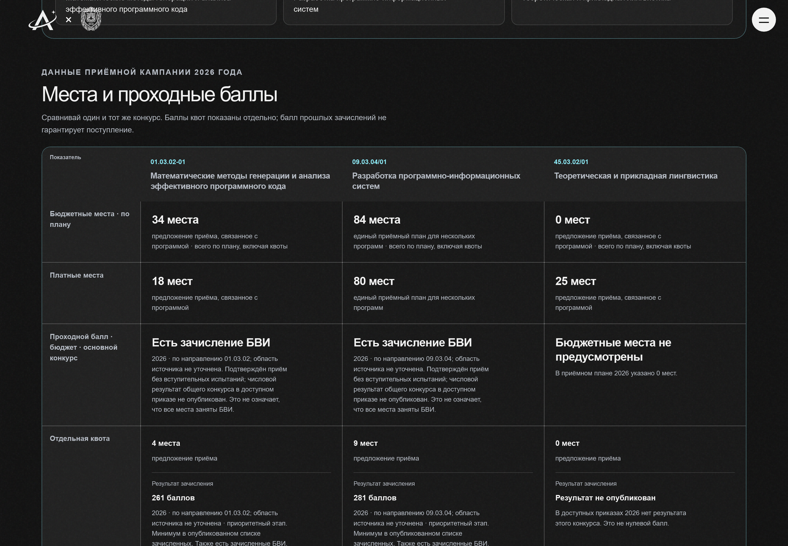
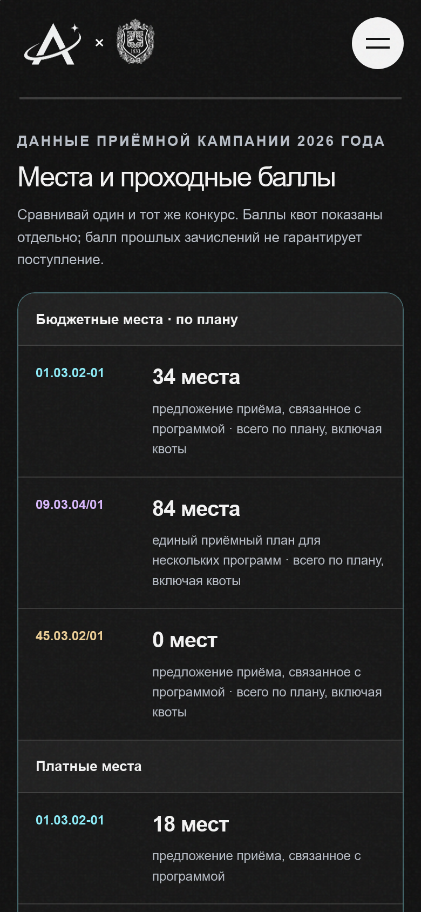

# Исправление данных приёма — 19 октября 2026

## Результат

Исправлены парсер, API и представление результатов приёма. Новый набор опубликован атомарно в отдельной локальной PostgreSQL 16; опубликованный исходный release не изменялся. Локальный сайт на `http://127.0.0.1:4180` использует исправленный API на порту 8003.

| Проверка | Было | Стало |
|---|---:|---:|
| Программы с точной связью с приёмным предложением | 106 / 152 | 118 / 152 |
| Однозначные одиночные предложения | 106 | 108 |
| Подтверждённые группы профилей | 0 | 3 группы, 10 связей |
| Пулы особой / отдельной квоты на уровне предложения | 104 агрегированных | 254 отдельных |
| Искусственные конфликты численности особой / отдельной квоты | 50 | 0 |
| Числовые результаты основного бюджетного конкурса, правильно распознанные как общий конкурс | 0 | 46 |
| Сохранённые текущие результаты зачисления | 311 | 311 |
| Сохранённые результаты БВИ | 86 | 86 |
| Целевые пулы «направление + организация» | 582 | 582 |

Это исправление полноты обработки доступного набора источников, а не заявление о полном покрытии всех фактов приёмной кампании. У 34 профилей каталога точной связи с текущим приёмным предложением всё ещё нет; перечень ниже.

## Причины

1. **Старая агрегация квот.** Особая и отдельная квоты объединялись по направлению, хотя числа относились к разным предложениям. Например, два разных профиля 01.03.03 имели 2 и 4 места особой квоты: это два факта, а не конфликт. Набор теперь пересобирается из сохранённых строк приложения 8.1 на уровне предложения.
2. **Составные коды и группы.** Парсер принимал только один код направления и мог переносить предыдущий код на строку `40.05.03 / 40.05.01`. Перечисления нескольких профилей и кафедр не имели представления в scalar `program_key`. Исправлено чтение явного кода; группы подтверждаются только при однозначном совпадении всех явно перечисленных профилей и кафедр. Добавлен один узкий alias исходной опечатки «Специализированые» для 15.05.02 / МТ7.
3. **Формулировка общего конкурса.** Официальный приказ использует «на места в рамках КЦП текущего года». Классификатор метаданных относил её к `other`. Добавлено точное правило после правил квот и БВИ; «особой квоты … КЦП» остаётся особой квотой.
4. **Потеря БВИ в интерфейсе.** Фильтр сравнения искал только числовой результат. Теперь БВИ — отдельное состояние, а не пустой балл. При отсутствии числового общего конкурса и наличии приоритетного БВИ показано «Есть зачисление БВИ», с пояснением, что это не доказывает заполнение всех мест олимпиадниками.
5. **Метаданные целевых квот.** Старый опубликованный mapper не отдавал организацию и кампус. Текущий mapper сохраняет их. В исходных 582 строках: 542 московских, 25 калужских, 15 мытищинских. Межкампусные места не приписываются московской программе.
6. **Разные названия каталога и приёмного плана.** Эти строки не исчезли: интерфейс показывает название предложения из документа и его числа отдельно. Похожее название не считается подтверждённой идентичностью профиля.

## Источники и неизменность чисел

Для основного бюджетного конкурса повторно разобран [официальный приказ МГТУ](https://priem.bmstu.ru/lists/upload/orders/first_msk_main.pdf). SHA-256 полученных байтов совпал с ранее сохранённым source artifact:

`bba340a47c433e4d54fa2d1223ecdcde1ed535089a85c6e003d680a6ac29aa6b`.

Повторная обработка подтвердила те же 46 агрегированных числовых результатов; изменился тип конкурса. Все 311 текущих результатов независимо сравнены через старый удалённый и новый локальный API по направлению, финансированию, этапу, статусу и значению, с сохранением кратности записей. Значения не изменились. Официальный PDF обрабатывался в памяти, персональные строки абитуриентов не сохранялись.

SHA-256 приложения 8.1 в сохранённом наборе:

`553f0c31af6038441770aabdf86acd79c77000cbe5fcb193991f6cf4054597d0`.

## Контракт и гарантии

- Старые маршруты и scalar `program_key` сохранены. В `AdmissionOfferingRecord` добавлено поле `shared_program_keys`, по умолчанию пустое. OpenAPI и TypeScript-типы сгенерированы.
- Групповая связь использует существующие `source_relationships`: тип `offering_includes_catalog_program`, evidence `explicit_appendix_8_1_profile_group`, источник и locator строки. Проверяются релиз, кампус, направление, все участники и отсутствие неоднозначного соответствия. Ошибка любого участника запрещает подтверждение всей группы.
- API читает участников группы пакетно внутри закреплённого релиза. Тест на 100 предложений проверяет один batch отношений и один batch программ; N+1 не добавлен.
- На реальной PostgreSQL 16 пакетный и независимый последовательный read model дают одинаковые DTO, включая группы. Исправлен и отдельно проверен fallback для реализации repository без необязательных batch-методов. [SQL-профиль и EXPLAIN ANALYZE](docs/data/admission-repaired-read-profile.json): 100 предложений из 127, 16 SQL, 30,73 мс суммарного SQL, 56,01 мс обработки приложения, 161 740 байт ответа. Это один локальный профиль, а не устойчивый production latency percentile.
- Общий приёмный план показывается у каждого участника с явной подписью «единый приёмный план для нескольких программ». Он не означает столько мест на каждый профиль.
- КЦП в приложении — всего по приёмному плану, **включая квоты**. Интерфейс не называет эту сумму местами общего конкурса и не прибавляет квоты повторно.
- Отдельная, особая и целевая квоты имеют разные строки и результаты. Целевые пулы направления/заказчика показываются отдельным контекстом, без распределения между профилями. Кампус должен быть явно подтверждён.
- `0`, отсутствие числа, БВИ и ошибка загрузки различаются. При опубликованном нуле мест показано «Бюджетные места не предусмотрены». БВИ не подменяет неизвестный числовой балл.
- `other` не используется как общий конкурс. Точный результат программы имеет приоритет перед результатом направления, включая случай «программа БВИ, направление numeric».

## Публикация и профтест

Исходный bundle: `42616ee9348ee009fa1b297f7ef697862134835e562c7840f413643ce71d2130`.

Исправленный кандидат без контекста публикации: `2926bc58f5b3832aea042e4e8e4268888da956977d94534e1212aa9a9ea848dc`.

Опубликованный локальный bundle с `release_context.json`: `5869df2bb3776eff25751c608027eac3b529cee5c368adb1fcaf8431ccf1b615`.

Контекст закреплён за исходным release UUID `160f0e1d-869f-5003-b2bc-a5834138cd0d` и его digest. Первая попытка публикации незакреплённого кандидата была отклонена `STALE_ACTIVE_RELEASE`; защита не отключалась. Корректно закреплённый кандидат прошёл стандартную валидацию и атомарную публикацию. Структура академических таблиц не менялась.

Проверка под настоящей ролью `andromeda_api_runtime` выявила необходимость отдельной ACL-миграции `c7e2b4a91d63`: `SELECT` на существующей таблице нормализованных `source_relationships` для роли `andromeda_api_readonly`. Владелец БД уже мог читать её, поэтому проверки только под владельцем не обнаруживали проблему. Права записи и чтение raw `source_observations` не добавлены. Перед развёртыванием нового API нужна эта миграция; старые releases не переписываются. Добавлен отдельный PostgreSQL тест реальных прав и равенства owner/runtime DTO.

Файлы дисциплин, курсов, программ, кафедр, направлений и учебных планов побайтово не изменились. Все 14 915 входов JeV повторно проверены по ключу, названию и `input_sha256`, включая владельцев 14 165 строк учебных планов. Исходные результаты модели и вероятности сохранены; отдельный revalidation manifest закрепляет их за новым релизом. Профильный snapshot пересобран через API: 152 программы, 127 проверенных планов, 14 165 назначенных категорий. Статус модельной проверки (`needs_review`) сохранён, категория не удаляется из-за этого статуса.

Новый профильный snapshot нельзя выкладывать отдельно от соответствующего release: проверка `release_key` намеренно отклонит смешанный набор.

## Воспроизведение

Из корня монорепозитория:

```powershell
uv run --all-packages --no-sync python -m andromeda_parser.repair_admission_bundle data/bmstu-2026 output/admission-repaired-bundle --verify-main-orders
uv run --all-packages --no-sync academic-data bundle validate --input output/admission-repaired-bundle
```

Команда создаёт **новую** директорию, запрещает перезапись входа/выхода и выход через symlink, проверяет hash источника. Отчёт создаётся рядом: `output/admission-repaired-bundle-repair-report.json`. Для публикации в существующую БД нужен стандартный review context с её фактическим base release, затем штатный `academic-data bundle import --commit`. Нельзя копировать локальный UUID в другую БД без проверки базы.

Browser CI теперь пересобирает этот исправленный fixture перед импортом в пустую PostgreSQL 16 и сохраняет repair report как артефакт. SHA официального приказа проверяется; при изменении источника CI остановится, а не примет новые данные автоматически. Это добавляет сетевую зависимость от первичного сайта при сборке fixture. На свежей БД контекст замены существующего release не нужен, поэтому fixture имеет digest кандидата без `release_context.json`. Python 3.11 поддерживается, включая проверку junction через совместимый fallback.

Сырые локальные доказательства: `output/admission-audit/` — исходные read-only API ответы, результаты импорта, API parity, контекст публикации и manifest повторной проверки разметки. Они не содержат сохранённых заявлений или персональных строк абитуриентов.

В репозитории сохранён [машиночитаемый аудит](docs/data/admission-repair-audit.json): hash каждого исходного и изменённого файла, API parity, проверенные группы, все 34 несовпадения и доказательства неизменности классификационных входов.

### Стоимость декоративного слоя

Во время проверки WebKit при DPR=2 обнаружена отдельная задержка отрисовки. Декоративный SVG-шум занимал 300% ширины и высоты экрана: 9 площадей viewport, до учёта DPR. Уменьшение overscan до 120% уменьшает площадь этого слоя в 6,25 раза; диапазон смещения тоже уменьшен, края слоя остаются за экраном. Добавлен `will-change: transform`. Сама текстура, прозрачность и наложение на весь интерфейс сохранены.

SVG также получил явные intrinsic dimensions 180×180: `stitchTiles` позволяет повторять эту текстуру. Частота `.35`, три октавы и прозрачность `.05` сохранены. Это ограничивает размер растеризации исходной текстуры; размеры всего оверлея адаптируются к экрану.

Диагностические callback `requestAnimationFrame` в одном локальном WebKit DPR=2 до изменения: `1583, 3709, 5227` мс (только 3 callback за окно 5 секунд). После уменьшения оверлея, до задания intrinsic dimensions: `340, 443, 535, 642, 871, 1099, 1314, 1537` мс. Это короткая диагностика локального software renderer под тестовой нагрузкой, не оценка FPS или production p95. Отдельный эксперимент только с CSS `background-size` не дал улучшения; такое правило в продукт не добавлено. Регрессионный браузерный тест ограничивает размер слоя и исходного SVG, проверяет текстуру, `pointer-events: none` и реальное открытие меню.

### Пустые карточки после фильтрации в WebKit

Дополнительно воспроизведена ошибка `content-visibility: auto` на карточках каталога. Через две секунды после фильтрации 01.03.02 в DOM оставалась одна правильная карточка: `textContent` начинался с `01.03.02-01`, но `innerText` был пустым. Runtime override `content-visibility: visible` немедленно возвращал отрисованный текст. Удалены `content-visibility` и связанный `contain-intrinsic-size: auto 400px` из карточек. Повтор того же сценария с исправленной CSS возвращает непустые `innerText` и `textContent`, без override. Существующие проверки фильтрации и выбора двух программ не ослаблены; замена `innerText` на скрытый DOM-текст не использовалась. Это осознанный отказ от одной оптимизации layout ради работающего каталога во всех браузерах.

## Независимый review

Работали три специализированных агента: `admission_identity_audit` (парсер и repair CLI), `admission_scores_audit` (маршруты зачисления и API), `admission_independent_review` (независимый аудит).

Аудит обнаружил два P1: неоднозначный участник группы мог не запрещать scalar fallback; фраза «особой квоты … КЦП» могла стать общим конкурсом. Оба исправлены, добавлены adversarial regression tests. Финальный read-only аудит fallback и ACL не обнаружил P0/P1. Найденный P2 — устаревшая ожидаемая revision в скрипте восстановления backup и его README — исправлен на `c7e2b4a91d63`. Ограничение: нормализация кампусов намеренно строгая; текущий проверенный каталог московский, полнота филиальных программ не заявляется.

## Скриншоты





## Проверки и ограничения

| Проверка | Результат |
|---|---|
| TypeScript strict, ESLint, OpenAPI drift, production build | Пройдены |
| Vitest | 142 теста пройдены, 17 файлов |
| Полный настроенный Python regression | 145 пройдены, 1 skipped, 23 deselected; opt-in интеграции запущены отдельно |
| PostgreSQL 16: lifecycle, proposals, Directus DB permissions | 22 пройдены в отдельной БД на порту 55438 |
| PostgreSQL 16: настоящая runtime-роль | 5 пройдены; owner/runtime DTO равны, DML и raw observations отклонены с `42501` |
| PostgreSQL 16: read profile и EXPLAIN ANALYZE | 1 пройден отдельно на исправленном релизе; batch/unbatched DTO равны |
| Цепочка миграций, включая новый ACL head | 3 пройдены; downgrade/upgrade ACL проверен отдельно |
| Backup / restore PostgreSQL 16 | Пройден в уникальную временную БД; head `c7e2b4a91d63`, три схемы и 57 read-model таблиц подтверждены |
| Playwright, production build, Chromium / Firefox / WebKit | 151 пройден, 2 штатных skipped; 13,8 минуты, без retries |
| Vanilla unit regression | 23 пройдены; исходный Vanilla frontend не изменён |

Финальный браузерный прогон использовал API с настоящей read-only ролью, исправленную PostgreSQL 16, один worker и одинаковый production build. Он включает сравнение двух/трёх программ на шести ширинах, профтест, сохранение состояния, ошибки/повтор/отмену и cross-release отказы. Два scale-теста намеренно выполняются только в Chromium. Проверка responsive разделена на два теста по числу программ: все 12 исходных сценариев сохранены, прежний общий лимит 120 секунд теперь применяется к каждому набору из шести screenshot. Ранее один большой WebKit тест исчерпывал время на захват DPR=2 screenshot; критерии геометрии не ослаблены. Один прежний Firefox refresh сбой не повторился в трёх отдельных повторах и финальном полном прогоне. Промежуточные неудачные прогоны сохранены локально вместе с финальным результатом в `apps/web-react-poc/test-results/`.

Опциональный Directus HTTP smoke пропущен: не заданы URL и административные credentials. Реальные ограничения роли в PostgreSQL проверены. Сборка сообщает существующее предупреждение sourcemap CardSwap; это не ошибка сборки.

На Windows в `PATH` установлен PostgreSQL client 17: созданный им dump не восстановился в сервер 16 из-за `SET transaction_timeout`. Временная БД удалена штатным `finally`; исходная БД не затронута. Повтор с нативными `pg_dump` / `pg_restore` 16 в Docker прошёл ту же проверку revision/схем/числа таблиц. Успешный запуск именно PowerShell restore wrapper с клиентом 16 на хосте не заявляется.

**CONDITIONAL GO:** исправление подтверждено локальными регрессионными проверками и независимым аудитом. Полнота всех приёмных фактов, production latency и успешное удалённое развёртывание не заявляются. Требуются устранение блокирующих CI-проверок, действующая cloud-авторизация и проверка 34 несовпадающих профилей по первичным документам.

## GitHub

Работа продолжается в [PR #13](https://github.com/artemnoor/andromeda-bmstu-monorepo/pull/13), ветка `codex/comparison-responsive-refresh`. Реализация: [a36fa761](https://github.com/artemnoor/andromeda-bmstu-monorepo/commit/a36fa761ab4d890d5294c14ba0b918c0192ccae0). Актуальное состояние Actions и ссылки на прогоны доступны в [проверках PR](https://github.com/artemnoor/andromeda-bmstu-monorepo/pull/13/checks); зелёный CI в этом отчёте не заявляется. Предыдущий [прогон Actions](https://github.com/artemnoor/andromeda-bmstu-monorepo/actions/runs/39168785921) останавливался на существующих нарушениях контраста Vanilla frontend, до React browser job. Эти проверки не отключены, expected results не изменены ради зелёного CI.

Удалённая БД и production в этом исправлении не изменены. Существующая сессия Yandex Cloud не прошла аутентификацию; доступ SSH также не подтверждён. Локальная исправленная версия доступна независимо от этого. Перед удалённой публикацией нужны действующая авторизация, проверка текущего base release и совместное развёртывание API, набора данных и профильного snapshot.

## Профили без точного совпадения с приёмным планом

Список относится к связи с приёмной кампанией, а не к наличию учебного плана. Совпадение только кода направления/кафедры не подтверждает переименование или распределение общей строки по старым профилям.

| Направление / кафедра | Профиль каталога | Причина |
|---|---|---|
| 01.03.03 / ФН3 | Моделирование, анализ и оптимизация в механике, астродинамике и гидродинамике | В строке приёма другое название / профиль не перечислен |
| 09.03.01 / ИУ5 | Интеллектуальные системы обработки информации и управления | В строке приёма другое название / профиль не перечислен |
| 09.03.01 / ИУ6 | Программные и аппаратные средства систем искусственного интеллекта | В строке приёма другое название / профиль не перечислен |
| 09.03.01 / ИУ6 | Киберфизические системы и технологии искусственного интеллекта (адаптационный план № 2) | В строке приёма другое название / профиль не перечислен |
| 09.03.03 / ИБМ3 | Технологии разработки корпоративных информационных систем | Нет строки приёма с точным направлением и кафедрой |
| 10.05.03 / ИУ8 | Безопасность автоматизированных систем критически важных объектов | В строке приёма другое название / профиль не перечислен |
| 10.05.03 / ИУ8 | Разработка автоматизированных систем в защищенном исполнении | В строке приёма другое название / профиль не перечислен |
| 10.05.03 / ИУ10 | Безопасность значимых объектов критической информационной инфраструктуры | В строке приёма другое название / профиль не перечислен |
| 12.03.04 / БМТ1 | Биомедицинская электроника и биомехатроника | В строке приёма другое название / профиль не перечислен |
| 12.03.04 / БМТ1 | Биофотоника | В строке приёма другое название / профиль не перечислен |
| 12.03.04 / БМТ1 | Интеллектуальные биомедицинские системы | В строке приёма другое название / профиль не перечислен |
| 12.03.04 / БМТ1 | Тканевая инженерия и мягкая материя | В строке приёма другое название / профиль не перечислен |
| 12.03.04 / БМТ2 | Неинвазивные биомедицинские системы | В строке приёма другое название / профиль не перечислен |
| 12.03.04 / БМТ2 | Нейроинфобионика | В строке приёма другое название / профиль не перечислен |
| 12.03.04 / БМТ2 | Биомедицинская инженерия в приборостроительной индустрии | В строке приёма другое название / профиль не перечислен |
| 12.03.04 / БМТ3 | Биоинженерия живых систем | В строке приёма другое название / профиль не перечислен |
| 12.03.04 / БМТ3 | Здоровьесберегающие технологии | В строке приёма другое название / профиль не перечислен |
| 12.03.04 / БМТ3 | Управление в биомедицинской сфере | В строке приёма другое название / профиль не перечислен |
| 12.03.04 / БМТ5 | Управление продуктом в биомедицинской индустрии | Нет строки приёма с точным направлением и кафедрой |
| 13.03.02 / Э4 | Водородные установки и возобновляемые источники энергии | В строке приёма другое название / профиль не перечислен |
| 15.03.02 / Э5 | Компрессорное оборудование, нефтегазовые и газотранспортные системы | В строке приёма другое название / профиль не перечислен |
| 15.05.01 / МТ12 | Инновационные технологии и оборудование аддитивных производств | В строке приёма другое название / профиль не перечислен |
| 15.05.01 / Э5 | Системная инженерия вакуумных и пневматических систем и агрегатов | В строке приёма другое название / профиль не перечислен |
| 24.05.01 / СМ2 | Пилотируемые и автоматические космические аппараты и системы (отраслевая) | В строке приёма другое название / профиль не перечислен |
| 24.05.01 / СМ2 | Моделирование и информационные технологии проектирования ракетно-космических систем (отраслевая) | В строке приёма другое название / профиль не перечислен |
| 24.05.01 / СМ2 | Крылатые ракет (отраслевая) | В строке приёма другое название / профиль не перечислен |
| 24.05.06 / ИУ1 | Программные и аппаратные комплексы систем управления космических аппаратов (отраслевая) | В строке приёма другое название / профиль не перечислен |
| 24.05.06 / ИУ1 | Системы управления летательных и космических аппаратов (отраслевая) | В строке приёма другое название / профиль не перечислен |
| 24.05.06 / ИУ11 | Проектирование систем управления ракетно-космическими комплексами (отраслевая) | В строке приёма другое название / профиль не перечислен |
| 27.03.05 / ИБМ3 | Технологическое продюсирование в креативных индустриях | В строке приёма другое название / профиль не перечислен |
| 38.03.01 / ИБМ1 | Экономика малого и среднего бизнеса | В строке приёма другое название / профиль не перечислен |
| 38.03.01 / ИБМ5 | Экономика и финансы | В строке приёма другое название / профиль не перечислен |
| 38.03.02 / ИБМ4 | Менеджмент корпораций | В строке приёма другое название / профиль не перечислен |
| 38.03.02 / ИБМ7 | Цифровая трансформация бизнеса | В строке приёма другое название / профиль не перечислен |
