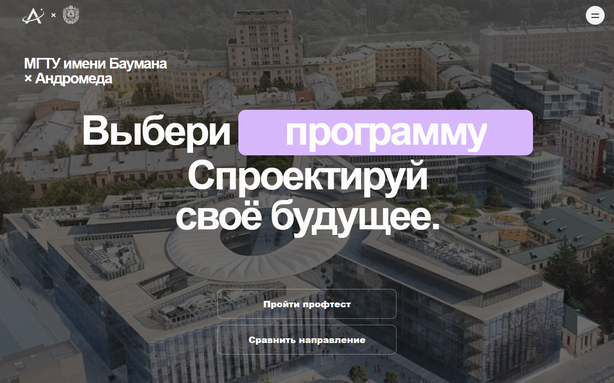

# Andromeda React application

React-приложение Andromeda для знакомства с направлениями МГТУ имени Баумана: главная страница, профтест, каталог программ и сравнение учебных планов и условий поступления.

Опубликованная версия: [andromedabmstu.ru](https://andromedabmstu.ru/). Имя каталога `web-react-poc` сохранено по историческим причинам; это исходники текущего сайта.

## Быстрый старт

Нужны Node.js 22.12+, npm 10 и работающий FastAPI из этого репозитория.

```powershell
Push-Location apps/web-react-poc
npm ci
$env:API_PROXY_TARGET = "http://127.0.0.1:8000"
npm run dev
Pop-Location
```

Откройте <http://127.0.0.1:4180>. Vite перенаправляет `/api/*` и `/openapi.json` на адрес `API_PROXY_TARGET` (по умолчанию `http://localhost:8000`). Страница `/discover` требует, чтобы снимок профилей соответствовал `release_key` активного академического выпуска API. При несовпадении приложение показывает ошибку и не смешивает версии данных.

## Маршруты

| URL | Содержание |
| --- | --- |
| `/` | Первый экран и обзор сценариев: тест, сравнение, каталог и источники. |
| `/discover` | Профориентационный тест, объяснение рекомендаций и подбор программ. |
| `/programs` | Каталог с поиском, подсказками, фильтрами и выбором программ для сравнения. |
| `/programs/:slug` | Страница конкретной программы: места, результаты зачисления, экзамены, учебный план и диаграммы. |
| `/compare` | Сравнение до трёх выбранных программ: учебные планы, нагрузка, классификации и данные приёма. |
| `/feedback` | Обратная связь. |

## Документация и скриншоты

Подробное руководство по пользовательским сценариям, данным, разработке и проверкам: [docs/РУКОВОДСТВО.md](docs/РУКОВОДСТВО.md).

Ссылки на готовое сравнение и результаты профтеста, скачивание PDF и поведение при смене выпуска: [docs/SHARING_AND_PDF.md](docs/SHARING_AND_PDF.md).

Замеры загрузки, исправления доставки и каталога, сырые результаты и оставшиеся ограничения: [docs/PERFORMANCE_FIXES_20261020.md](docs/PERFORMANCE_FIXES_20261020.md).

Текущий источник проходных баллов, проверка всех 152 программ и границы опубликованных данных: [docs/OFFICIAL_CARD_PASSING_SCORES.md](docs/OFFICIAL_CARD_PASSING_SCORES.md).

Разбор причин пропусков в приёмных данных, исправления БВИ и квот, границы соответствий и проверки: [ADMISSION_DATA_REPAIR_REPORT.md](ADMISSION_DATA_REPAIR_REPORT.md).



## Технологии и границы

- React 19, React Router Framework Mode, Vite, TypeScript strict, CSS Modules.
- FastAPI остаётся владельцем академических данных; UI обращается к нему через единый типизированный API adapter.
- OpenAPI и TypeScript-контракт проверяются из backend-кода; frontend не строит URL отдельных API в компонентах.
- Выбранные программы и избранное сохраняются в браузере через адаптер с поддержкой прежних ключей хранилища.
- Состав сравнения ограничен тремя программами. Академические чтения закрепляются за одним `release_key`; при смене активного выпуска во время загрузки UI не показывает смешанный результат.
- Неизвестное, отсутствующее и недоступное значение остаются различимыми. Проверенные источники показываются рядом с фактами, где это возможно.
- React-приложение обслуживает основной домен. Пример маршрутизации Nginx находится в `infra/nginx/andromeda-domain.conf`; прежнее Vanilla-приложение сохраняется отдельно.

Последние изменения интерфейса, замеры и границы данных: [POLISH_PERFORMANCE_20261026.md](docs/POLISH_PERFORMANCE_20261026.md). Полный список профилей без точной привязки мест: [ADMISSION_GAPS_20261026.md](docs/ADMISSION_GAPS_20261026.md).

## Проверки

Из `apps/web-react-poc`:

```powershell
npm run api:check
npm run typecheck
npm run lint
npm test
npm run build
npm run test:e2e
```

Полный E2E-прогон использует PostgreSQL 16 с тестовыми данными, FastAPI с read-only runtime-пользователем и Chromium. Не подключайте его к рабочей базе. В корневом CI также запускаются проверки Vanilla-приложения.

## Решения и исследования

- [Обновление сравнения и результаты профилирования](COMPARISON_REFRESH_REPORT.md)
- [Проверка удобства профтеста](PROF_TEST_USABILITY_REPORT.md)
- [Сторонние лицензии и атрибуция](THIRD_PARTY_NOTICES.md)
- [Исследование backend-производительности](BACKEND_PERFORMANCE_RESEARCH.md)
