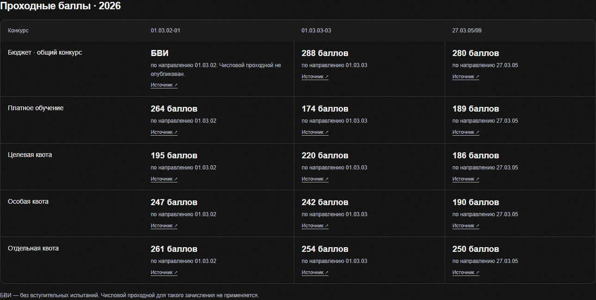
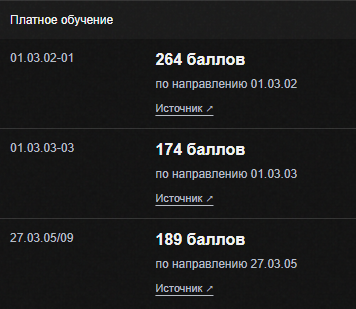

# Экзамены и проходные баллы

Обновление интерфейса от 19 октября 2026 года. Общие React-компоненты используются в карточке каталога и сравнении программ.

## Проходные баллы

Для предыдущего и текущего года показаны отдельные таблицы: бюджетный общий конкурс, платное обучение, целевая, особая и отдельная квоты. Среднего балла, максимального балла, отдельных строк БВИ и счётчиков зачисленных в этом интерфейсе нет.

- При числовом результате и БВИ одной области данных показан числовой минимум. Результат конкретной программы имеет приоритет перед результатом кафедры или направления.
- Если опубликован только результат БВИ, ячейка содержит «БВИ» с пояснением об отсутствии числового проходного. Это не утверждение, что все зачислены БВИ.
- «Нет мест» выводится только для текущего общего конкурса при подтверждённом нуле в плане и отсутствии противоречащего факта зачисления.
- «Не опубликован» отличается от нуля и отсутствия мест. План текущего года не используется для вывода о прошлом годе.
- Числовые результаты, источники и области данных разных лет и конкурсов не смешиваются.

В активном выпуске архивная статистика 2025 года содержит только платный приём. Бюджетные и квотные баллы 2026 года не подставляются в 2025 год. Неизвестный вид архивного конкурса не превращается автоматически в общий конкурс; известный `paid_admission_published_aggregate` отображается как платное обучение.

## Экзамены

Предмет и его минимум находятся в одной строке. Дерево AND/OR/AT_LEAST отображается непосредственно: все обязательные условия, один вариант на выбор, либо необходимое число из списка. Ноль сохраняется числом, отсутствующий минимум подписан отдельно.

Одинаковые наборы объединяются. Разные минимумы не объединяются; при отсутствии точной связи с профилем показываются варианты условий уровня направления. Ссылки на документы сохраняются.

В старых данных `applicant_category` содержит первые 420 символов PDF-страницы: это подтверждено кодом `parse_exam_requirements_pdf`, который записывает `heading` в `applicant_category_text`. Фрагменты таблиц с кодами направлений и заголовки приложений исключены из заголовка категории при отображении. Исходные API-записи и опубликованный академический выпуск не изменялись; реальная категория поступающих, когда она задана, остаётся частью группировки.

## Проверки

- TypeScript strict, ESLint изменённых файлов и production build проходят.
- 36 проверок Vitest в пяти файлах: академическая модель, таблица, БВИ, отмена/повтор загрузки, Boolean-условия экзаменов и регрессия PDF-текста.
- Playwright Chromium, production preview с реальным API ВМ: каталог и сравнение трёх программ.
- На ширинах 320, 390, 768 и 1440 px горизонтального переполнения страницы не обнаружено. На компьютере колонки программ имеют одинаковую ширину; на телефоне значения расположены под строкой конкурса с кодами программ.
- В DOM нет колонки среднего балла, отдельной строки БВИ, счётчиков зачисленных и фрагментов PDF в экзаменах.

Новые зависимости и HTTP-запросы не добавлялись. Регрессионные проверки backend и других страниц в рамках этого изменения не запускались.
