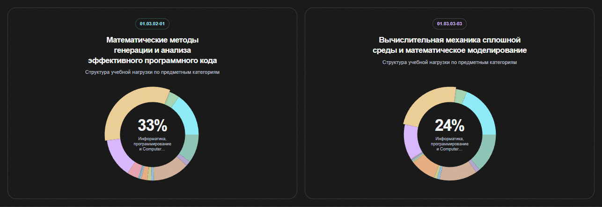
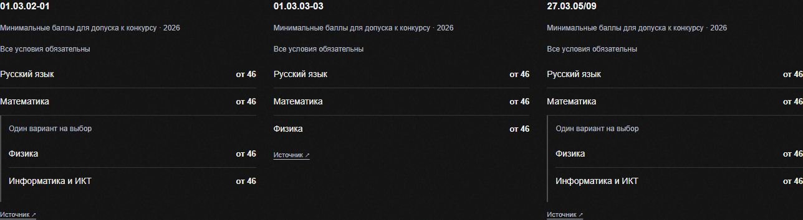

# Восстановление категорий и уточнение минимумов — 19.10.2026

## Причина

Активный выпуск `99e2f5a284abaf51303e5640e2661de8230e27d54fa3bc2492daef88526d5ff5` был опубликован с числом зачисленных, но без отдельного прогона классификации. В предыдущем выпуске `5869df2bb3776eff25751c608027eac3b529cee5c368adb1fcaf8431ccf1b615` сохранялись 14 915 результатов Jev; для нового release-scoped набора было 0. Справочник 16 категорий существовал, но API возвращал `subject_classification: null`. Поэтому легенда сохранялась, а дисциплины и диаграммы лишились распределения.

Статический snapshot профтеста также ссылался на предыдущий выпуск. Предыдущая проверка публикации ограничилась блоком поступления и не обнаружила потери категорий в учебных планах.

## Исправление

Сохранена резервная копия таблиц классификации. Из БД взят точный ZIP активного выпуска, проверен его SHA-256, затем все 14 915 входов проверены относительно исходного результата Jev: тип, внешний ключ, название, контекст и владельцы в `input_sha256`, вероятность каждой категории, ответ и версия модели. Новый manifest закрепляет неизменённые ответы за активным digest. Штатный импорт проверяет активный указатель ещё раз под блокировкой и атомарно добавляет новый полный прогон.

Результат: 14 165 строк учебных планов и 750 курсов. `result_sha256` остался `69ad22deba7518f4024d11a3489f7228fba6bf7c6061d213a154e1efcd537eb7`. Новых обращений к модели и новых расходов нет; `cost_rub` в отчёте относится к первоначальному запуску. Статусы `needs_review` и исходные вероятности сохранены. Старый выпуск и его назначения не переписывались.

Отчёт: [classification-restoration-20261019.json](data/classification-restoration-20261019.json).

Snapshot профтеста пересобран по текущему API: 152 программы, 127 проверенных планов, все 14 165 строк имеют категорию, из них 4 165 сохраняют `needs_review`.

SHA-256 исходных дисциплин snapshot остался прежним; значения каждого профиля при сопоставлении по `program_key` не изменились. Обновлены release metadata и время генерации. Проверка публикации до обновления статики воспроизвела ошибку несовпадения snapshot/API.





Добавлен явный режим импортёра `--revalidate-manifest <новый-файл> --expected-release-key <точный-ключ>`. Он разрешает перенос результатов только с точным bundle активного выпуска и неизменными входами. Шесть Python-проверок покрывают перенос без изменения исходного manifest, смену активного выпуска, чужой bundle, изменение входов, запрет перезаписи и ZIP.

## Интерфейс и проверка публикации

Таблицы проходных баллов за 2025 год удалены из каталога и сравнения. Минимумы экзаменов выбираются по подразделению на основании точного SHA-256 и позиции таблицы Приложения 1; московским программам не подставляются Калуга и ГУИМЦ. Вместо двух вариантов показывается один подтверждённый набор. Подробности и ограничения: [ADMISSION_PRESENTATION.md](ADMISSION_PRESENTATION.md).

После каждой публикации данных или статических файлов запускать:

```powershell
node apps/web-react-poc/scripts/check-academic-deployment.mjs https://адрес-сайта
```

Проверка отклоняет несовпадение release snapshot/API, неполное покрытие snapshot и отсутствие категорий у живых строк учебного плана. Пустой учебный план не считается успешной проверкой. Это минимальный контроль публикации; он не заменяет полный аудит академических данных.
