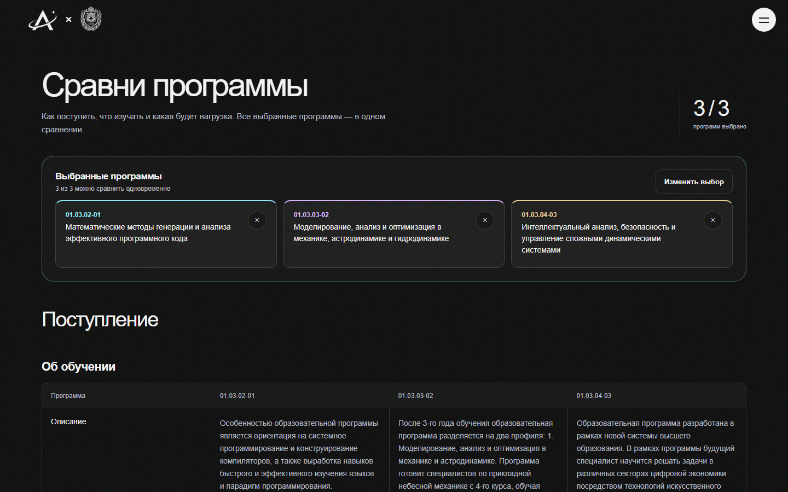
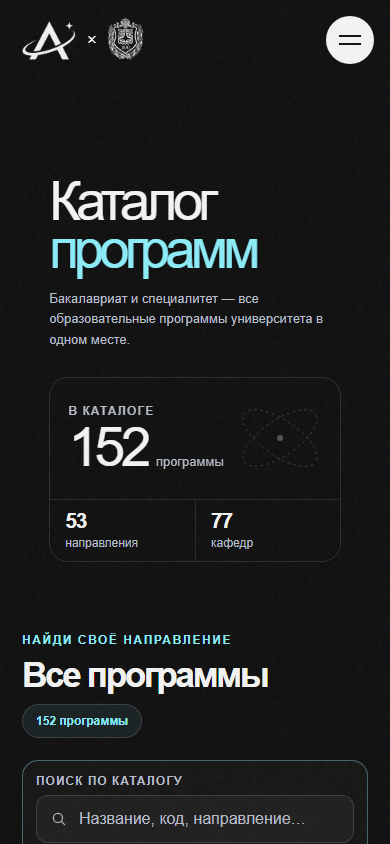

# Производительность: исследование и исправления, 20 октября 2026

Статус: **CONDITIONAL GO**. Измеримая польза от настройки доставки и небольших изменений React подтверждена. Полная загрузка сравнения всё ещё требует 38 API-запросов; цель 1800 мс в этом окружении не достигнута.

Реализация: `01a3686`, ветка `codex/comparison-responsive-refresh`, [PR #13](https://github.com/artemnoor/andromeda-bmstu-monorepo/pull/13). Развёрнуто на VM: <http://185.135.175.229>. Данные и FastAPI в этой итерации не менялись.

## Что вызывало задержки

1. **Расхождение конфигураций Nginx.** Контейнерная конфигурация в репозитории включала gzip, а конфигурация работающей VM сжимала только HTML. JSON, JavaScript и CSS передавались целиком. Для сравнения это 2 275 790 байт JSON и около 838 КБ JavaScript. Добавлена отдельная конфигурация VM с её реальными путями и upstream; контейнерная конфигурация не подменяется.
2. **Синхронное построение 152 карточек каталога.** До изменений наблюдались длинные задачи 132–145 мс. Теперь React добавляет по 12 карточек, отдавая управление браузеру между порциями. Все карточки появляются автоматически; поиск и счётчики используют полный каталог. Новая фильтрация отменяет устаревшие порции. Не используется `content-visibility`, ранее вызывавший пустые карточки в WebKit.
3. **Подписки карточек.** Изменение списка сравнения обновляло каждую карточку. Теперь карточка подписана на собственное булево состояние; актуальный лимит трёх программ проверяется непосредственно при нажатии. Добавлены проверки независимости карточек и сохранения выбора.
4. **Скачки при загрузке.** Верхний margin глобального fallback выходил за корневой контейнер, сдвигая BODY на 120 пикселей. `display: flow-root` сохраняет отступ внутри корня. В сравнении добавлены статические заглушки выбранных программ, чтобы загрузка каталога не вставляла целую новую строку над содержимым.
5. **Телефон загружал избыточную фотографию.** Исходник 568 342 байта сохранён; добавлены WebP 480/800/1122 px. `sizes="max(100vw, 80svh)"` учитывает масштабирование `object-fit: cover` по высоте. При 390×844 DPR1 выбирается 800 px (216 944 байта), DPR2 — 1122 px (332 568 байт). Пропорции и кадрирование сохранены.

## Что не подтвердилось

- Старый шейдер облаков не смонтирован. Удалять его ради ускорения текущего экрана бессмысленно.
- После завершения анимации CardSwap постоянные записи стилей не наблюдались. Подозрение на бесконечную лишнюю перерисовку не подтвердилось.
- Замена SVG-шумовой текстуры растровой не дала значимой пользы в эксперименте WebKit; изменение отклонено.
- VM не была ограничена памятью или загрузкой CPU во время исследования. Локальные HTTP-чтения API: release около 5–6 мс, programs100 68–138 мс, plans100 50–52 мс, directions около 33 мс. Это время HTTP/backend вместе, **не** отдельное время SQL. Новый SQL-профайлер не включался; оснований для миграции БД, Redis или увеличения VM не получено.

## Методика и сырые данные

Chromium 156.0.8078.4, production-сборка, 1440×900, одна VM/PostgreSQL 16, один неизменный academic release, три одинаковых точных program keys. Каждый переход — новый browser context; API/DB прогреты, кеш PostgreSQL принудительно не сбрасывается. Нет искусственного CPU/network throttling в основных измерениях. Тестовые браузеры и сборки не работают параллельно с benchmark.

- [Исходные 3 повтора на страницу](data/performance-20261020-before.json): сохранены из вывода первоначального исследования, до исправлений.
- [Чередуемое A/B identity/gzip](data/performance-20261020-after.json): по 3 повтора, **одинаковый окончательный код**, разные заголовки Accept-Encoding. Порядок чередуется для уменьшения влияния фиксированного порядка. Реальные request/response headers отдельно проверены: identity без Content-Encoding, gzip с Content-Encoding:gzip.
- [10 повторов окончательной версии](data/performance-20261020-after-10.json).
- [Проверка байтовой эквивалентности транспорта](data/performance-20261020-transport.json).

Каталог считается готовым только после появления **всех 152 карточек**, а не первой порции. Дополнительно сохраняется время первой карточки. Сравнение — после полного release marker и отсутствия ошибок загрузки admission; профтест — после первого вопроса. Необязательные admission-запросы профтеста учитываются после сетевого затишья, но не сдвигают критерий готовности вопроса. Для главной ожидается декодирование фоновой фотографии.

Скрипт `scripts/profile-site-pages.mjs` сохраняет waterfall API, объёмы encodedBodySize, длинные задачи, CLS, стадии сравнения, ошибки и release guard до/после серии. Total transfer — сумма ResourceTiming transferSize, без основного HTML-документа. Browser timing включает накладные расходы ожидания автоматизации. Это небольшая лабораторная выборка; production p95 не заявляется.

### Результат

Медианы. До: 3 повтора; после: 10. Для чётного числа повторов медиана — среднее двух центральных значений. Объёмы в десятичных КБ.

| Страница / критерий | До, мс | После, мс | Изменение | Диапазон после, мс | Передача до → после, КБ |
| --- | ---: | ---: | ---: | --- | ---: |
| Главная / фото декодировано | 1190 | 1151 | −3,3% | 1127–1176 | 768 → 369 |
| Каталог / все 152 карточки | 2796 | 1781 | −36,3% | 1632–2231 | 1456 → 338 |
| Сравнение / полный release marker | 4156 | 2704 | −34,9% | **2645–12354** | 3222 → 570 |
| Профтест / первый вопрос | 4699 | 2139 | −54,5% | 2107–2196 | 2799 → 460 |

Первая карточка каталога: медиана 1682 мс, все карточки — 1781 мс. Условие полной готовности не ослаблено. Максимальная длинная задача каталога в исходных трёх измерениях 145 мс; в окончательных десяти — 98 мс. Это разные выборки, не обещание верхнего предела для всех устройств.

API-запросы не исключались: 0/6/38/12 для главной/каталога/сравнения/профтеста соответственно. API bytes: 947 289 → 141 060 в каталоге; 2 275 790 → 235 743 в сравнении; 2 191 463 → 239 904 в профтесте. CLS главной и каталога снизился с 0,0833 до 0, сравнения — с 0,1163 до 0. У профтеста остаётся небольшой 0,000276 вместо 0,08361.

В чередуемом A/B на **одном финальном коде** медианы identity → gzip: каталог 2868 → 1779 мс, сравнение 4189 → 2647 мс, профтест 4668 → 2162 мс. Значит большая часть сокращения полного времени — эффект доставки. Главная 1179 → 1162 мс: уменьшение байтов не означает сопоставимого выигрыша во времени на этой сети.

**Выброс не исключён из результатов.** В повторе №8 сравнение заняло 12 354 мс. Первый запрос API начался лишь на 10 458 мс; стадия получения данных сравнения затем заняла 1639 мс, модель 4,6 мс, единственная длинная задача — 66 мс. Доказательств медленного React-render или SQL как причины этих дополнительных десяти секунд нет. Первоначальный скрипт сохранял waterfall только API, поэтому конкретный начальный ресурс/сетевую причину задним числом установить нельзя. Скрипт дополнен полным resource waterfall (DNS/connect/TTFB/download) и NavigationTiming; [отдельная последующая серия](data/performance-20261020-comparison-followup.json) сохраняется без замены исходного выброса. Причина этого единичного случая остаётся ограничением исследования.

В последующих 10 сравнениях диапазон 2651–3157 мс; выброс не воспроизведён. Это дополнительная проверка, а не повод исключить первоначальный результат.

### Отзывчивость поиска: явный компромисс

Отдельный Chromium probe при замедлении CPU ×4: [выбор, лимит и длинные задачи](data/performance-20261020-smoke.json), [первые и полные DOM commits фильтрации](data/performance-20261020-filter-commits.json). До изменений один probe возвращал 109/52/5/152 карточки за 259/192/96/511 мс. После первое полезное обновление — 247/114/82/59 мс, а **все** результаты — 832/334/82/935 мс. Четыре длинные задачи в отдельном probe после изменений: 54–58 мс. Порционный вывод отдаёт браузеру управление и быстрее возвращает начало списка при очистке, но завершение всего длинного списка на медленном CPU становится дольше. Это не ускорение каждой операции; tradeoff зафиксирован. Оба probe малы и не служат статистической гарантией.

## Согласованность и безопасность данных

Release: `bmstu-2026:a6fd1db98f75bd2426db4e11ddcc2bdf2234f6a4ec80c0b3a524168e7912428f:bmstu-2026-bundle-v5`.

Сохраняются 152 программы, 128 подтверждённых планов, 14 278 классифицированных строк. `check-academic-deployment.mjs` проверяет совпадение release снимка и API, полное покрытие снимка, а также 100 фактических строк curriculum с классификациями. Это выборочная проверка live API, а не заявление о повторной независимой валидации каждой строки БД.

Gzip меняет только транспорт: декодированные тела проверяются SHA-256 против identity. Не менялись program keys, joins, DTO, публикация, проверки release, null/zero, источники, суммы часов и правила рекомендаций. Данные `/data/` и HTML остаются `no-cache`; кеш академических ответов поверх API не добавляется.

## Проверки

- TypeScript strict, полный ESLint, Vitest: **158 тестов, 20 файлов — проходят**; production build проходит. Имеются существующие предупреждения sourcemap CardSwap и future flags React Router; они не скрыты.
- Chromium, Firefox, WebKit: первоначальная серия 105 сценариев — 98 прошли, 7 потребовали разбора. Шесть ошибок были устаревшей проверкой общего числа ячеек: прежние 10 вместо текущих 12 (2 по обучению, 5 по зачислению, 5 по баллам). Проверки заменены отдельными утверждениями для каждой таблицы; академические ожидаемые значения не менялись.
- Седьмая ошибка: Firefox получил 503 `/release` во время внешнего перезапуска API. Журнал systemd зафиксировал остановки/запуски 06:15:12 и 06:16:15 UTC, `NRestarts=0`; эта работа перезапускала только Nginx в 06:09 UTC. Trace и error context сохранены локально в `output/perf-20261020/`. Причинную связь с React заявлять нельзя.
- Повтор девяти затронутых сценариев с контрольными случаями — **9/9 во всех трёх движках**. Таким образом все 105 уникальных сценариев в конечном счёте проверены успешно; это не один чистый запуск 105/105.
- Покрыты: шесть ширин 320/390/600/768/1024/1440, две и три программы, суммы часов/категории, таблицы/диалог, навигация/фокус, поиск, сохранение, профтест до результатов, повтор/отмена, невалидный снимок, смена release, недоступное storage.
- После окончательных изменений отдельно выполнен smoke всех 152 карточек и фильтрации в Chromium/Firefox/WebKit; mobile image source и отсутствие горизонтального overflow проверены при DPR1/2.

Состояние интерфейса после публикации:

GitHub Actions для реализации: [CI](https://github.com/artemnoor/andromeda-bmstu-monorepo/actions/runs/39381305185). На момент подготовки отчёта прошли lint, web-react-poc-check, web-check, domain-contracts и directus; полные PostgreSQL/Python/browser jobs ещё выполнялись. Зелёный статус всего CI не заявляется; PR не сливается до завершения обязательных проверок.

## Развёртывание и ограничения

Статика опубликована из production build с сохранением старых hashed assets для уже открытых вкладок. Предыдущий каталог доступен на VM как `/var/www/andromeda-preview.01a3686-backup`. Исходная конфигурация Nginx сохранена в `/home/yc-user/deploy/backups/perf-20261020/nginx.conf`; новая конфигурация проходит `nginx -t`. API и БД не перезапускались и не перезаписывались этой работой.

Сжатие существенно уменьшает сетевую цену существующего API, но не сокращает количество HTTP round trips. На одинаковом финальном коде identity и gzip позволяют отделить этот эффект от шума прежних замеров. Пакетный вывод каталога уменьшает отдельные блокировки, но сам по себе не гарантирует сокращения времени построения всех 152 карточек. Времена SQL, Android GPU/FPS, медленная мобильная сеть и production p95 требуют отдельного измерения. Новые универсальные API, изменения БД и визуальный редизайн для этих исправлений не понадобились.
