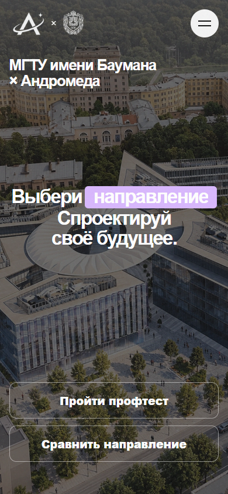
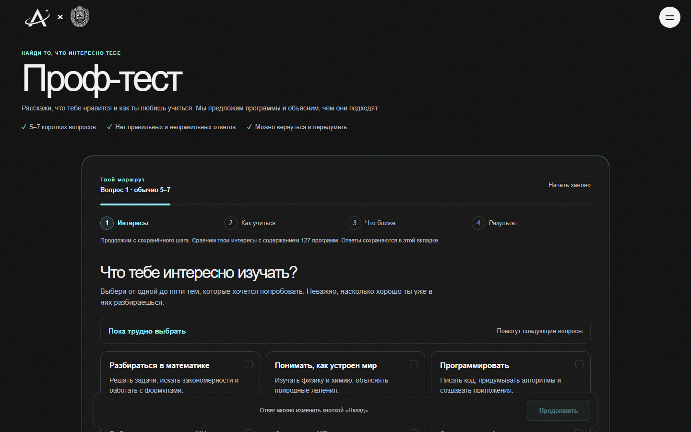
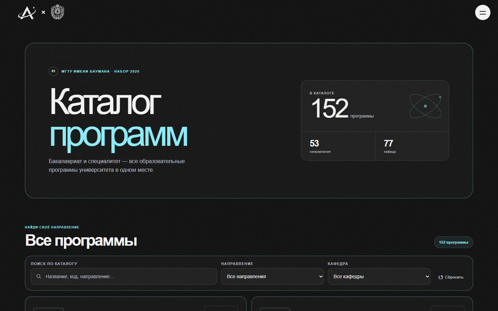
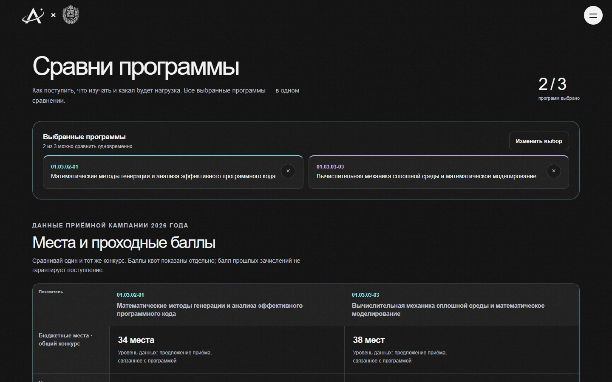
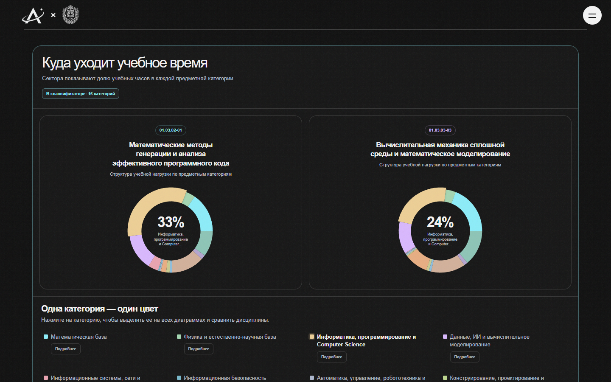

# Andromeda — руководство по приложению

[← README приложения](../README.md)

Руководство описывает актуальную React-версию: основные пользовательские пути, обращение с академическими данными и запуск проекта для разработки.

## Что может сделать абитуриент

1. **Сравнить программы**, если направления уже выбраны. В каталоге отмечают до трёх программ; в сравнении видны учебные планы и данные приёмной кампании.
2. **Начать с интересов**, если решение ещё не принято. Проф-тест задаёт короткие вопросы, показывает, почему программа попала в рекомендации, и позволяет перейти к каталогу.
3. **Изучить каталог** по названию, коду, направлению или кафедре; раскрыть сведения о приёме и открыть ссылки на первичные источники.

## Страницы

### Главная `/`

Первый экран ведёт к профтесту и сравнению. Дальше показаны сравнение двух направлений, два сценария выбора (сначала исследовать интересы или сразу сравнить программы), каталог, поступление и источники, а затем повторный призыв к действию.




Блок «Индивидуальный подход» раскрывает сценарий с профтестом и сценарий для тех, кто уже определился. В первом случае карточка раскрыта при первом знакомстве со страницей.

### Проф-тест `/discover`

Тест предлагает несколько коротких групп вопросов: интересы, предметы, задачи и предпочтения в учёбе. Можно выбрать несколько подходящих вариантов, вернуться к предыдущим ответам и скорректировать выбор. Результат объясняет связь между ответами, предметными категориями и рекомендуемыми программами.



Рекомендации зависят от опубликованного снимка профилей, привязанного к тому же академическому выпуску, что и каталог API. Если выпуск не совпадает, тест останавливается с ошибкой согласованности. Не следует вручную менять `release_key` в снимке: сначала нужно проверить происхождение, полноту и классификации данных, затем пересобрать снимок для нужного выпуска.

### Каталог `/programs`

В каталоге доступны поиск, фильтры по направлению и кафедре, карточки программ, избранное и добавление программ в сравнение. Карточка показывает идентификатор и связи с направлением/кафедрой, а раскрытые детали — сведения о местах, баллах и требованиях вместе с доступными источниками.



### Сравнение `/compare`

Сравнение поддерживает до трёх программ, выбранных в каталоге. Страница показывает данные приёмной кампании, нагрузку учебных планов, классификацию предметов и источники. Если подтверждённого плана нет или связь требует проверки, это обозначается явно; данные другого года или другой программы автоматически не подставляются.





## Единый стиль страниц

Каталог, сравнение и профтест используют графитовые поверхности, бирюзовые обводки и полупрозрачную подсветку при наведении, как на главной. Общая палитра задана в `app/root.module.css`; она применяется также к фильтрам, раскрытым условиям поступления, окнам категорий, результатам теста и состояниям загрузки и ошибки. Нативные поля и списки используют тёмную цветовую схему браузера.

Диаграммы используют уже установленный Recharts. Цвет каждой категории одинаков на всех кругах и в легенде; программы различаются бирюзовым, сиреневым и песочным акцентами. На телефонах круги пропорционально уменьшаются и остаются в одном ряду. Приёмные показатели и дисциплины сохраняют код программы рядом со значением.

Оформление использует CSS без новых библиотек и дополнительных запросов к API. Новых постоянных анимаций нет; настройка уменьшения движения сохраняется. Эти изменения оформления сами по себе не доказывают ускорение загрузки академических данных.

Проверка оформления 19 октября 2026 года: TypeScript, ESLint, production-сборка и 134 модульных теста прошли. На production-сборке прошли 35 браузерных сценариев в каждом из Chromium, Firefox и WebKit — всего 105 проверок. Набор охватывает контраст, раскрытые условия поступления, сравнение двух и трёх программ на ширинах 320/390/600/768/1024/1440 px, окно дисциплин, фильтры, прохождение профтеста и его результаты, повторную загрузку и отмену запросов. Проверки сравнения и каталога использовали опубликованный read-only API; ошибки и переходы профтеста дополнительно проверялись с управляемыми ответами API.

## Академические данные и ограничения

- FastAPI — единственный источник академических записей для UI. Клиент использует общий API adapter и типы, сгенерированные из OpenAPI.
- Составной экран сравнения закрепляет чтения за одним `release_key`. При смене активного выпуска во время загрузки приложение не считает результат успешным.
- Программа идентифицируется устойчивым ключом, а план используется только при подтверждённой связи с программой и однозначном выборе последней проверенной версии.
- Ноль, пустое значение, неизвестный факт и недоступные данные не подменяют друг друга.
- Баллы, места и квоты показываются в заданном контексте конкурса; неподтверждённые связи с программой не выдаются за факт.
- Для профтеста агрегаты классификаций также должны соответствовать тому же выпуску. Ошибка согласованности блокирует рекомендации, а не ослабляет проверку.

Подробные технические решения и исследования: [обновление сравнения](../COMPARISON_REFRESH_REPORT.md), [проверка профтеста](../PROF_TEST_USABILITY_REPORT.md), [исследование backend-производительности](../BACKEND_PERFORMANCE_RESEARCH.md).

## Разработка

Запустите FastAPI и подготовьте тестовую базу согласно корневому [руководству разработки](../../../README.md), затем из каталога приложения выполните:

```powershell
npm ci
$env:API_PROXY_TARGET = "http://127.0.0.1:8000"
npm run dev
```

Страница откроется на <http://127.0.0.1:4180>. Для отдельного API используйте `API_PROXY_TARGET`; локальный сервер не должен читать production-данные. Профильный снимок должен совпадать с `release_key` API.

### Команды качества

```powershell
npm run api:check
npm run typecheck
npm run lint
npm test
npm run build
npm run test:e2e
```

E2E-набор рассчитан на изолированную PostgreSQL 16, FastAPI с read-only ролью и Chromium. На CI отдельно проверяется Vanilla-приложение. Не обновляйте эталонные академические данные, чтобы скрыть расхождения: сначала выясните причину и добавьте регрессионное покрытие.

## Снимки интерфейса

Файлы в `docs/screenshots/` — сжатые скриншоты ширины 1440×900 и телефона 390×844, снятые в октябре 2026 года в Chromium. Для сценариев, которым нужен согласованный снимок профиля, использовался read-only API с тем же выпуском, что и snapshot профтеста. Это иллюстрации интерфейса, а не benchmark-результаты.

## См. также

- [Архитектурные решения и профилирование сравнения](../COMPARISON_REFRESH_REPORT.md)
- [Проверка удобства профтеста](../PROF_TEST_USABILITY_REPORT.md)
- [Исследование backend-производительности](../BACKEND_PERFORMANCE_RESEARCH.md)
